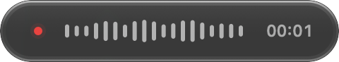

<div align="center">
  

  # LocalVoice

  **Free, fully local dictation for Apple Silicon Macs.**

  Tap a key, speak, and the text lands wherever your cursor is —
  transcribed by Whisper, NVIDIA Parakeet, Nemotron or Qwen3-ASR, running entirely on your Mac.

  
  
  

  
</div>

## Why

LocalVoice runs **Whisper Large V3 Turbo**, **Parakeet**, **Nemotron Streaming** and **Qwen3-ASR** on your Mac for free. Dictation audio and text are processed locally. The private app's Model Library contacts Hugging Face only when you request a model download, and the app looks for updates on GitHub once a day (Settings › General › Updates turns that off). Built on [ctrlSPEAK](https://github.com/patelnav/ctrlspeak), with a native recording pill, automatic speech recognition, and a configurable hotkey.

## Install

Download the signed and notarized app from [Releases](https://github.com/Schereo/localvoice/releases/latest), or install it with [Homebrew](https://brew.sh):

```sh
brew install --cask schereo/tap/localvoice
```

Requires an Apple Silicon Mac with macOS 15 or later. The cask lives in [Schereo/homebrew-tap](https://github.com/Schereo/homebrew-tap) and follows each release; `brew upgrade --cask localvoice` updates, `brew uninstall --zap --cask localvoice` also removes settings and models.

Releases after 1.3.0 update themselves: a new version shows up in the menu bar menu and under **Settings › General › Updates**, and installs in place, usually as a patch of a few MB. Permissions, models and settings stay. LocalVoice checks GitHub once a day; **Check for Updates…** looks right away, and the switch under **Settings › General › Updates** turns the daily check off. More: [In-app updates](docs/setup.md#in-app-updates).

To build it yourself: the private ARM64 app is staged with [`scripts/build-app.sh`](scripts/build-app.sh). It keeps its runtime inside the app and does not use or change Homebrew on the target Mac. Build the [Core ML worker](docs/development-checks.md#nvidia-providers) to include the NVIDIA models. In the app, use **Models…** to download or select a model, **Set Up Permissions…** to enable dictation, and optionally **Launch at Login**. See [Setup](docs/setup.md) for build inputs and release checks.

The previous source installer is available as an explicit compatibility option. Run `./install.sh --plan` before deciding whether to use `./install.sh --legacy-homebrew`.

## Use

| Key | Action |
|---|---|
| Hotkey tap (default: triple-tap **Ctrl**) | Start recording / stop and insert |
| **Enter** / **Esc** while recording | Insert / discard |
| **Cmd+,** while recording | Open the settings in your text editor |

Everything is configured in one file, `~/.config/localvoice/config` — hotkey (`hotkey = cmd,2`), language, microphone, mic standby. Edits apply within seconds, no restart needed; the menu bar icon offers the same settings as menus: **[docs/configuration.md](docs/configuration.md)**. Recording uses the built-in mic by default, so connected AirPods keep their audio quality. The mic opens only while you record (the indicator stays honest); if nothing can take the text, it stays on the clipboard. More: **[docs/usage.md](docs/usage.md)**.

For the private app, disable **Launch at Login**, quit LocalVoice, and move the app to Trash. Models and preferences are kept separately.

## More

- **[docs/setup.md](docs/setup.md)** — installer steps, permissions wizard, code signing, health checks, uninstall
- **[docs/configuration.md](docs/configuration.md)** — the config file: hotkey, language, microphone, mic standby
- **[docs/usage.md](docs/usage.md)** — keys, language modes, insertion behaviour
- **[docs/how-it-works.md](docs/how-it-works.md)** — architecture: app identity, pill protocol, download pipeline, onset buffer
- **[docs/development-checks.md](docs/development-checks.md)** — automated checks, UI preview, offline model smoke test
- **[docs/adding-a-language.md](docs/adding-a-language.md)** — how to add a third language beyond DE/EN
- **[CONTRIBUTING.md](CONTRIBUTING.md)** — project layout and how to hack on it

## Credits & license

Built on [ctrlSPEAK](https://github.com/patelnav/ctrlspeak) by Nav Patel (MIT), [MLX Whisper](https://github.com/ml-explore/mlx-examples) by Apple, [Whisper Large V3 Turbo](https://huggingface.co/mlx-community/whisper-large-v3-turbo), [mlx-qwen3-asr](https://github.com/moona3k/mlx-qwen3-asr) and [Qwen3-ASR](https://github.com/QwenLM/Qwen3-ASR) by Alibaba's Qwen team. MIT — see [LICENSE](LICENSE) and [NOTICE.md](NOTICE.md).
